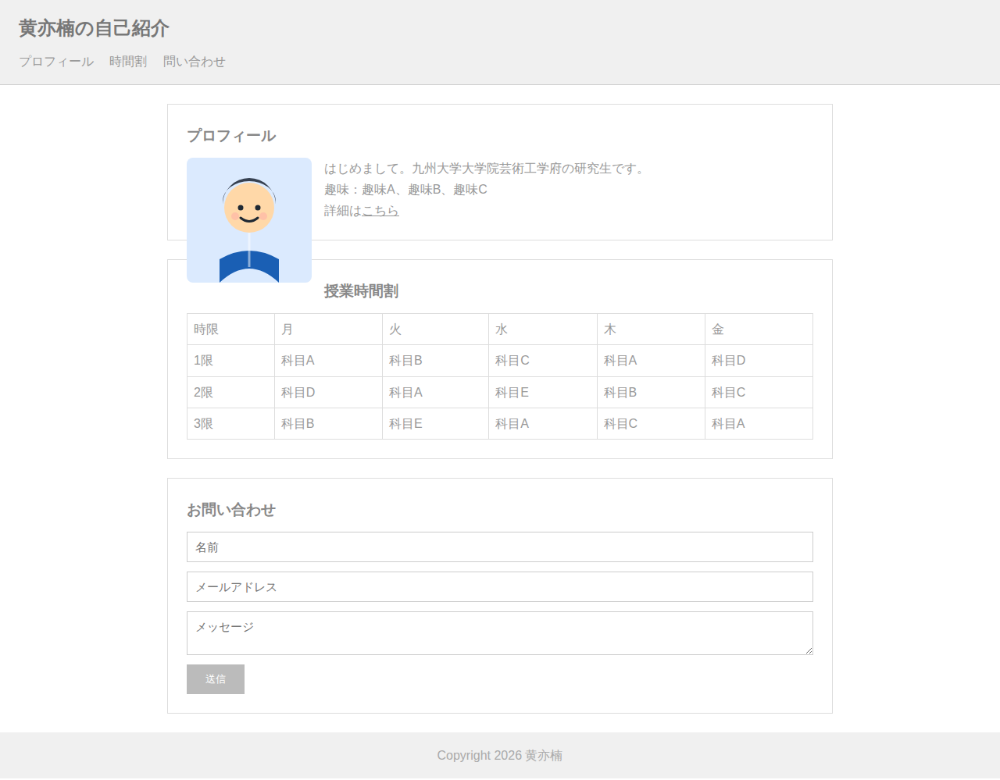
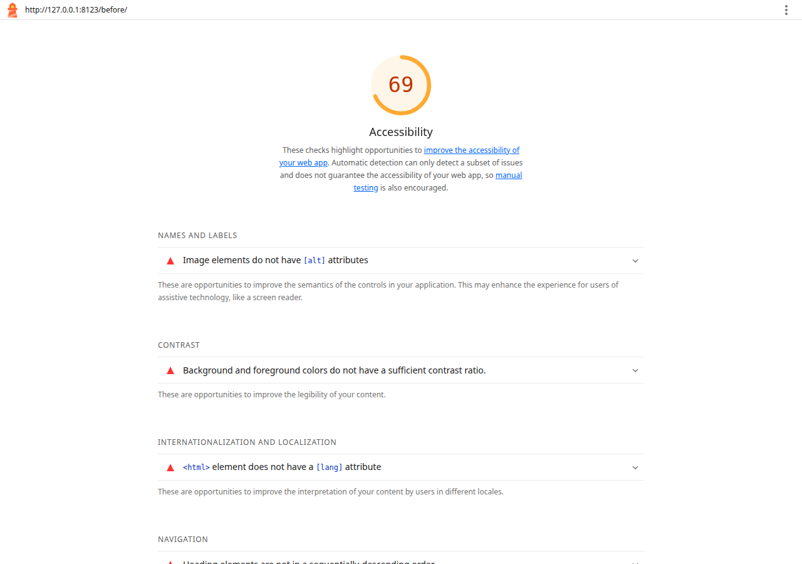
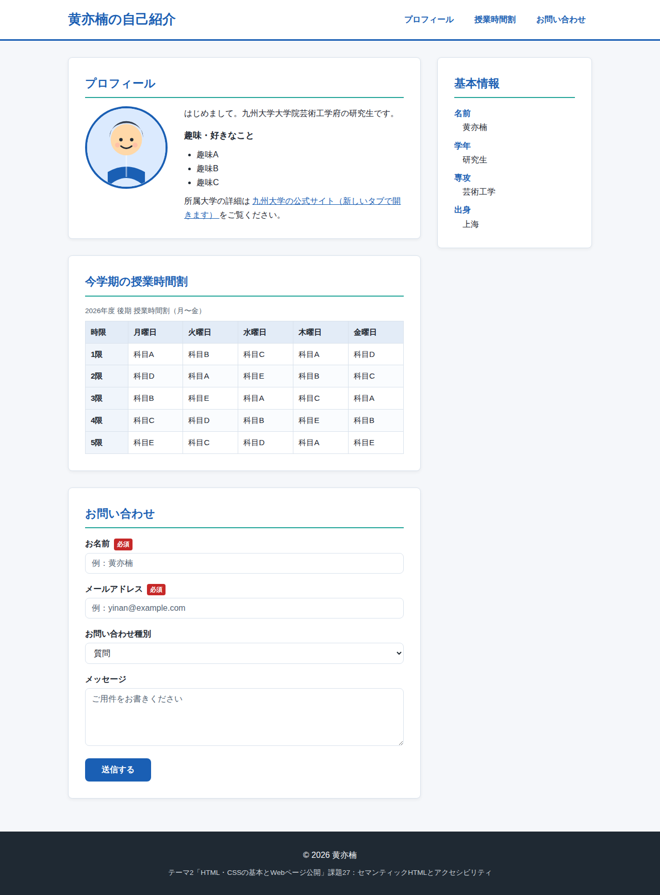
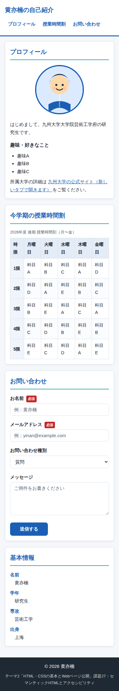
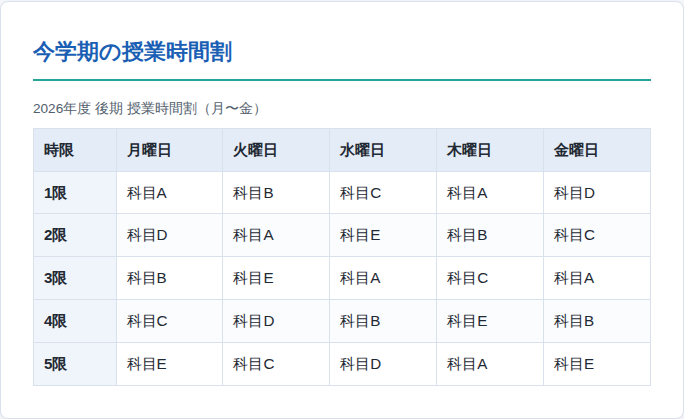
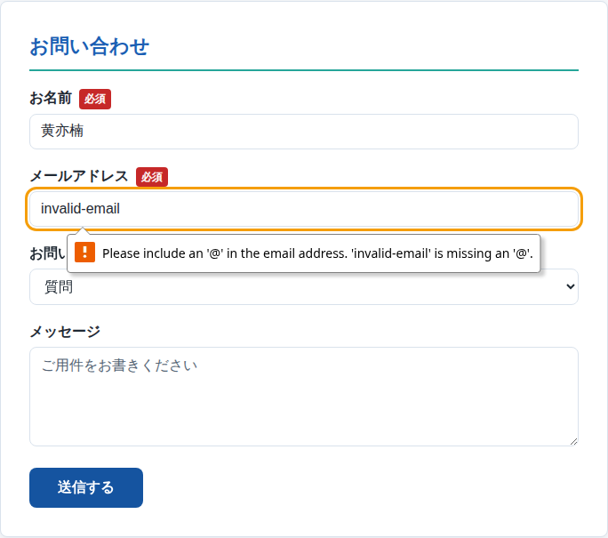
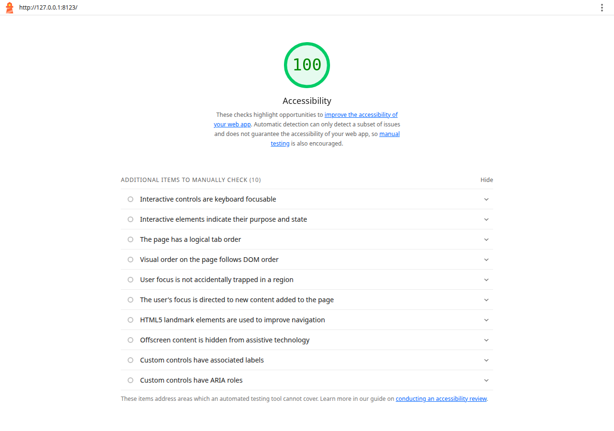

## 課題27：セマンティックHTMLとアクセシビリティ


## 1. 改善前の状態（コード → スクリーンショット → スコア）

改善前は課題26までの段階を想定し、`<div>` だけで構成したバージョン。
以下の抜粋中のコメント `※` が、Lighthouse に指摘された問題点・手動改善点の場所を示す。

### 1.1 改善前のコード（抜粋）：before/index.html

```html
<!DOCTYPE html>
<html>
<!-- ※ lang 属性なし（Lighthouse 指摘：html-has-lang） -->
<head>
  <meta charset="UTF-8">
  <meta name="viewport" content="width=device-width, initial-scale=1">
  <title>自己紹介ページ</title>
  <link rel="stylesheet" href="style.css">
</head>
<body>
  <!-- ※ div だけで構成。ランドマーク（main など）がない（指摘：landmark-one-main） -->
  <div class="header">
    <h1>黄亦楠の自己紹介</h1>
    <div class="nav">
      <a href="#profile">プロフィール</a>
      <a href="#schedule">時間割</a>
      <a href="#contact">問い合わせ</a>
    </div>
  </div>

  <div class="content">
    <div class="section" id="profile">
      <!-- ※ h1 の次が h3。見出しレベルが飛んでいる（指摘：heading-order） -->
      <h3>プロフィール</h3>
      <!-- ※ img に alt 属性なし（指摘：image-alt） -->
      
      <p>はじめまして。九州大学大学院芸術工学府の研究生です。</p>
      <p>趣味：趣味A、趣味B、趣味C</p>
      <!-- ※ リンクテキストが「こちら」で行き先がわからない（手動改善点） -->
      <p>詳細は<a href="https://www.kyushu-u.ac.jp/ja/" target="_blank">こちら</a></p>
    </div>

    <div class="section" id="schedule">
      <!-- ※ thead/th/scope を使わない表。全セルが <td>（指摘：td-has-header） -->
      <table>
        <tr><td>時限</td><td>月</td><td>火</td><td>水</td><td>木</td><td>金</td></tr>
        <tr><td>1限</td><td>科目A</td><td>科目B</td><td>科目C</td><td>科目A</td><td>科目D</td></tr>
        …（3限まで同様）
      </table>
    </div>

    <div class="section" id="contact">
      <!-- ※ label なし・placeholder のみ（手動改善点：label 対応付け） -->
      <form action="#" method="post">
        <input type="text" placeholder="名前" required>
        <input type="email" placeholder="メールアドレス" required>
        <textarea placeholder="メッセージ"></textarea>
        <input type="submit" value="送信">
      </form>
    </div>
  </div>

  <div class="footer">Copyright 2026 黄亦楠</div>
</body>
</html>
```

### 1.2 改善前のコード（抜粋）：before/style.css（コントラスト不足が指摘の対象）

```css
body {
  background: #ffffff;
  color: #999999;      /* ※ 白背景とのコントラスト比 約2.8:1（要求は 4.5:1 以上）
                          → Lighthouse の color-contrast 指摘（28要素）の主因 */
  …
}

.nav a    { color: #999999; … }   /* ※ リンクも低コントラスト */
.header h1{ color: #777777; … }
.section h3 { color: #888888; … }
table td  { color: #999999; … }
.footer   { color: #aaaaaa; … }
```

### 1.3 改善前のスクリーンショット（PC幅）



### 1.4 改善前の Lighthouse スコア：69（6項目の指摘あり）



> 生レポート：`reports/lighthouse-before.report.html` をブラウザで開くと、指摘ごとの詳細（該当要素・修正提案）を確認できる。

---

## 2. 改善内容のメモ

### 2.1 Lighthouse に自動指摘された 6 項目とその改善

| # | 指摘（監査ID） | 改善前の問題 | 改善内容 |
|---|----------------|--------------|----------|
| 1 | color-contrast（28要素） | 文字色 `#999999` と背景のコントラスト比が約 2.5〜2.84:1（要求は 4.5:1 以上） | CSS変数で `--text-color:#1f2933`（約13:1）、`--text-muted:#52606d`（約7:1）、リンク `--main-color:#1a5fb4`（約6.3:1）、プレースホルダ `#556575`（約5.9:1）に変更し、全要素で 4.5:1 以上を確保 |
| 2 | heading-order | `<h1>` の直後に `<h3>` が出現（`<h2>` を飛ばしていた） | 各セクション見出しを `<h2>` に変更し、「h1 → h2 → h3」の正しい階層に修正 |
| 3 | html-has-lang | `<html>` に lang 属性がなく、読み上げ言語を判定できない | `<html lang="ja">` を追加 |
| 4 | image-alt | `` に alt 属性がなく、画像の内容が伝わらない | `alt="顔絵イラスト"` を追加 |
| 5 | landmark-one-main | ページ全体が `<div>` のみで、本文（main）ランドマークがない | `<header>` `<nav>` `<main>` `<section>` `<aside>` `<footer>` のセマンティックタグで骨組みを再構築（課題27の本体） |
| 6 | td-has-header | 表の見出し行が `<td>` で作られ、データセルと見出しの対応が機械的に判定できない | `<thead>` `<tbody>` と `<th>`（列見出しは `scope="col"`、行見出しは `scope="row"`）に書き換え、`<caption>` も追加 |

### 2.2 Lighthouse では自動検出されないが、併せて手動改善した 6 項目

| 項目 | 改善前 | 改善後 |
|------|--------|--------|
| リンクテキスト | 「こちら」 | 「九州大学の公式サイト（新しいタブで開きます）」 |
| スキップリンク | なし | 「本文へスキップ」をページ先頭に追加 |
| フォーカス表示 | ブラウザ既定のみ | `:focus-visible` でオレンジの太いアウトラインを表示 |
| フォームのラベル | placeholder のみ | `<label for="…">` で全入力欄に対応付け |
| ナビの区別 | — | `<nav aria-label="メインナビゲーション">` |
| タップターゲット | 小さい | リンクに `padding: 8px 12px` 以上を付与（24px 以上） |

### 2.3 改善結果

| 項目 | 改善前 | 改善後 |
|------|--------|--------|
| Lighthouse アクセシビリティスコア | **69** | **100** |
| 自動指摘（不適合）件数 | 6 件（うちコントラスト 28 要素） | **0 件** |

---

## 3. 改善後の状態（コード → スクリーンショット → スコア）

### 3.1 使用したセマンティックタグと役割

| タグ | 役割 | このページでの使用箇所 |
|------|------|------------------------|
| `<header>` | ページのヘッダー（サイト名・ロゴ） | ページ上部「黄亦楠の自己紹介」 |
| `<nav>` | ナビゲーションのまとまり | プロフィール／授業時間割／お問い合わせへのリンク群 |
| `<main>` | ページに1つだけの本文領域 | 3つの `<section>` のコンテナ |
| `<section>` | 見出しを持つテーマ別の区画 | プロフィール・授業時間割・お問い合わせ |
| `<aside>` | 本文を補足する情報 | 右側「基本情報」サイドバー |
| `<footer>` | ページのフッター | コピーライト等 |

### 3.2 改善後の HTML（骨組みの抜粋）：index.html

```html
<!DOCTYPE html>
<html lang="ja">                 <!-- 改善③：言語宣言 -->
<head>
  <meta charset="UTF-8">
  <meta name="viewport" content="width=device-width, initial-scale=1">
  <title>黄亦楠の自己紹介 | ポートフォリオ</title>
  <link rel="stylesheet" href="style.css">
</head>
<body>

  <!-- 手動改善：スキップリンク（Tab キーで本文へ直行できる） -->
  <a class="skip-link" href="#main">本文へスキップ</a>

  <!-- ① <header>：ページのヘッダー -->
  <header class="site-header">
    <h1 class="site-title">黄亦楠の自己紹介</h1>
    <!-- ② <nav>：ナビゲーション。aria-label でランドマークを区別 -->
    <nav aria-label="メインナビゲーション">
      <ul class="nav-list">
        <li><a href="#profile">プロフィール</a></li>
        <li><a href="#schedule">授業時間割</a></li>
        <li><a href="#contact">お問い合わせ</a></li>
      </ul>
    </nav>
  </header>

  <div class="page-grid">          <!-- レイアウト：CSS Grid（課題26） -->
    <!-- ③ <main>：本文。スキップリンクの飛び先（改善⑤：main ランドマーク） -->
    <main id="main">

      <!-- ④ <section>：プロフィール -->
      <section id="profile" class="card" aria-labelledby="profile-heading">
        <h2 id="profile-heading">プロフィール</h2>    <!-- 改善②：h3 → h2 -->
        <!-- 改善④：alt 属性を追加 -->
        
        <p>はじめまして。九州大学大学院芸術工学府の研究生です。</p>
        <h3>趣味・好きなこと</h3>                     <!-- h2 の次は h3（階層を飛ばさない） -->
        <ul>
          <li>趣味A</li><li>趣味B</li><li>趣味C</li>
        </ul>
        <!-- 手動改善：リンクテキストで行き先がわかる -->
        <a href="https://www.kyushu-u.ac.jp/ja/" target="_blank" rel="noopener">
          九州大学の公式サイト（新しいタブで開きます）
        </a>
      </section>

      <!-- ④ <section>：授業時間割テーブル（課題25・改善⑥） -->
      <section id="schedule" class="card">
        <h2>今学期の授業時間割</h2>
        <table>
          <caption>2026年度 後期 授業時間割（月〜金）</caption>
          <thead>
            <tr>
              <th scope="col">時限</th><th scope="col">月曜日</th><th scope="col">火曜日</th>
              <th scope="col">水曜日</th><th scope="col">木曜日</th><th scope="col">金曜日</th>
            </tr>
          </thead>
          <tbody>
            <tr><th scope="row">1限</th><td>科目A</td><td>科目B</td><td>科目C</td><td>科目A</td><td>科目D</td></tr>
            …（5限まで同様）
          </tbody>
        </table>
      </section>

      <!-- ④ <section>：お問い合わせフォーム（課題24） -->
      <section id="contact" class="card">
        <h2>お問い合わせ</h2>
        <form action="#" method="post">
          <!-- 手動改善：<label for> で入力欄を対応付け -->
          <label for="name">お名前 <span class="required-badge" aria-hidden="true">必須</span></label>
          <input type="text" id="name" name="name" required
                 autocomplete="name" placeholder="例：黄亦楠">
          <!-- type="email" + required：ブラウザの入力チェックを利用（課題24） -->
          <label for="email">メールアドレス <span class="required-badge" aria-hidden="true">必須</span></label>
          <input type="email" id="email" name="email" required
                 autocomplete="email" placeholder="例：yinan@example.com">
          <label for="kind">お問い合わせ種別</label>
          <select id="kind" name="kind">…</select>
          <label for="message">メッセージ</label>
          <textarea id="message" name="message" rows="5" placeholder="ご用件をお書きください"></textarea>
          <button type="submit">送信する</button>
        </form>
      </section>
    </main>

    <!-- ⑤ <aside>：補足情報のサイドバー -->
    <aside class="sidebar card" aria-labelledby="sidebar-heading">
      <h2 id="sidebar-heading">基本情報</h2>
      <dl>
        <dt>名前</dt><dd>黄亦楠</dd>
        <dt>学年</dt><dd>研究生</dd>
        <dt>専攻</dt><dd>芸術工学</dd>
        <dt>出身</dt><dd>上海</dd>
      </dl>
    </aside>
  </div>

  <!-- ⑥ <footer>：ページのフッター -->
  <footer class="site-footer">
    <p>&copy; 2026 黄亦楠</p>
  </footer>
</body>
</html>
```

### 3.3 改善後の CSS（要点の抜粋）：style.css

```css
/* ① CSS変数（課題22）：色・余白を一元管理（改善①：コントラスト比 4.5:1 以上を確保） */
:root {
  --main-color:   #1a5fb4;  /* リンク・ボタン：白背景と約 6.3:1 */
  --text-color:   #1f2933;  /* 本文：約 13:1 */
  --text-muted:   #52606d;  /* 補足テキスト：約 7:1 */
  --placeholder:  #556575;  /* プレースホルダ：約 5.9:1 */
  --focus-color:  #f59e0b;  /* フォーカスリング */
  --space-md: 16px; --space-lg: 32px; --radius: 8px;
}

/* ② ページ全体のレイアウト：CSS Grid（課題26）― 本文(1fr) + サイドバー(300px) */
.page-grid {
  display: grid;
  grid-template-columns: minmax(0, 1fr) 300px;
  gap: var(--space-lg);
}

/* ③ スキップリンク：通常は画面外。Tab キーでフォーカスされたときだけ表示 */
.skip-link   { position: absolute; top: -100px; … }
.skip-link:focus { top: 8px; }

/* ④ フォーカススタイル（手動改善）：キーボード操作の現在位置を明示 */
a:focus-visible, button:focus-visible,
input:focus-visible, select:focus-visible, textarea:focus-visible {
  outline: 3px solid var(--focus-color);
  outline-offset: 2px;
}

/* ⑤ レスポンシブ対応（課題23）：600px 以下（スマホ幅）で切り替え */
@media (max-width: 600px) {
  .page-grid    { grid-template-columns: 1fr; }   /* 1カラムに（サイドバーは下へ） */
  .header-inner { flex-direction: column; }       /* ロゴとナビを縦に積む */
  .profile-flex { flex-direction: column; }       /* 画像を上、文章を下に */
}
```

### 3.4 改善後のスクリーンショット

**PC幅（全体表示）**



**スマートフォン幅 390px（レスポンシブ対応）**



**授業時間割テーブル（拡大）**



**フォームの入力チェック（type="email" のバリデーションが働いた状態）**



> メールアドレス欄に「invalid-email」（@なし）を入力して送信したところ、ブラウザの入力チェックが働き送信がブロックされた状態。

### 3.5 改善後の Lighthouse スコア：100（指摘 0 件）



> 生レポート：`reports/lighthouse-after.report.html` をブラウザで開くと詳細を確認できる。

---

## 4. セマンティックタグとアクセシビリティの解説

### 4.1 セマンティックHTMLとは

タグ名自体が「中身が何か」を表すマークアップのこと。
`<div>` は「ただの区画」だが、`<header>` は「ここがヘッダー」だと人間にも機械にも伝わる。

**利点**

1. **スクリーンリーダー（視覚障害者向けの読み上げソフト）** が、ランドマーク（`main`・`nav` など）や見出し単位でページ内を移動できる。
2. **検索エンジン** がページ構造を正しく理解できる（SEO）。
3. **開発者** にとってコードが読みやすく、CSS セレクタも直感的になる。

### 4.2 各タグの解説

| タグ | 解説 |
|------|------|
| `<header>` | ページや区画の導入部。サイト名・ロゴ・キャッチコピーを置く。 |
| `<nav>` | 主要なナビゲーションのまとまり。複数ある場合は `aria-label` で区別する。 |
| `<main>` | ページに **1 つだけ** 置く本文領域。スキップリンクの飛び先になる（Lighthouse の landmark-one-main が検査）。 |
| `<section>` | 見出しを持つテーマ別の区画。`aria-labelledby` で見出しと紐付けると、読み上げ時にタイトルが案内される。 |
| `<aside>` | 本文を補足するサイドバー。このページでは「基本情報」を配置。 |
| `<footer>` | ページの末尾。コピーライトや作者情報を置く。 |

### 4.3 セマンティックタグとセットで使うアクセシビリティ技術

- **`<html lang="ja">`**：ページの言語宣言。読み上げ音声の言語が正しく選ばれる。
- **見出し階層（h1 → h2 → h3）**：レベルを飛ばさない。見出しジャンプ機能の前提。
- **`alt` 属性**：「目を閉じて読み上げを聞いて、画像の内容が分かるか」を基準に記述する。
- **`<th scope="col"/"row">`**：表のデータセルに「どの列・行の見出しか」を明示する。
- **`<label for="…">`**：入力欄とラベルの対応付け。ラベルをクリックしても入力欄にフォーカスが移る。
- **スキップリンク**：ページ先頭の「本文へスキップ」。通常は画面外に隠し、Tab キーのフォーカスで表示する。
- **`:focus-visible`**：キーボード操作時の現在位置を、太いアウトラインで明示する。
- **コントラスト比 4.5:1 以上**：文字と背景の明暗差。薄いグレー文字は視力の弱い人に読めない。