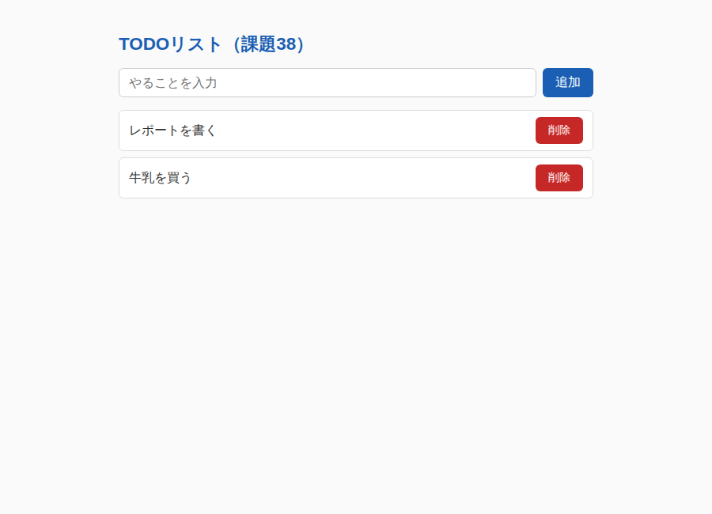
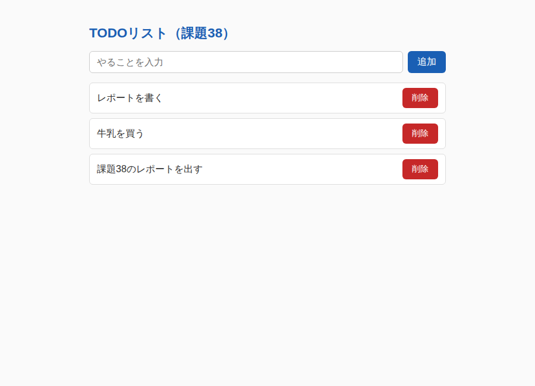
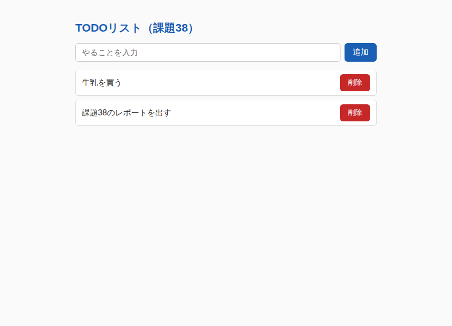

# 課題38：入力フォームによる動的追加・削除


入力ボックスに入れた文字を「追加」ボタンでリストに加え、各項目の「削除」ボタンでその項目を取り除くTODOリストです。
データは配列 `todos` で一元管理し、画面は常に「配列の内容を描画し直す」ことで更新します。

コードの各部分の役割：

| 部分 | 役割 |
|------|------|
| `getElementById` の3行 | 入力ボックス・追加ボタン・リスト（`<ul>`）の要素を取得する |
| `const todos = [...]` | データを保持する配列（初期値2件） |
| `renderList()` 関数 | 配列の中身を `<li>` と「削除」ボタンにして `<ul>` に描画する。`createElement` で動的生成し、表示は `textContent` を使う |
| 削除ボタンの `addEventListener` | 押された項目を `splice` で配列から取り除き、`renderList()` で再描画する |
| 追加ボタンの `addEventListener` | 入力値を `push` で配列に追加し、入力欄をクリアして再描画する |
| 最後の `renderList()` | ページ読み込み時の初期表示を行う |

## コード

### index.html（該当部分）

```html
<script type="module" src="main.js"></script>

<input type="text" id="todo-input" aria-label="新しい項目"
       placeholder="やることを入力">
<button id="add-btn" type="button">追加</button>

<ul id="todo-list"></ul>
```

### main.js（該当コード）

```javascript
const input = document.getElementById('todo-input');
const addButton = document.getElementById('add-btn');
const list = document.getElementById('todo-list');

const todos = ['レポートを書く', '牛乳を買う'];

function renderList() {
  list.textContent = '';

  todos.forEach((todo, index) => {
    const li = document.createElement('li');
    li.textContent = todo;

    const deleteButton = document.createElement('button');
    deleteButton.textContent = '削除';
    deleteButton.addEventListener('click', () => {
      todos.splice(index, 1);
      renderList();
    });

    li.appendChild(deleteButton);
    list.appendChild(li);
  });
}

addButton.addEventListener('click', () => {
  const value = input.value.trim();
  if (value === '') return;
  todos.push(value);
  input.value = '';
  renderList();
});

renderList();
```

## 動作確認







